# One carry, five investors: share classes for a bitcoin basis strategy

**Taehyun (Terry) Kim** · [GitHub](https://github.com/scotankboi) · [LinkedIn](https://www.linkedin.com/in/scoterry)

> **Status: complete (2026-10-05).** Public data from January 2021 to 30 September 2026. Every
> number below computed from market data is written by one command (`python -m src.pipeline`) to
> `data/processed/results.json`, `data/processed/validation.json` or
> `data/processed/vol_overlay/results.json`; `python tests/check_readme.py` checks the README against
> them. Figures from other sources (fee schedules, FTX's distributions) are cited. Fees, costs and fund
> terms are assumptions. This is a hypothetical backtest on public data, not a fund, a track record or
> an offer; legal, tax and regulatory feasibility is not assessed.

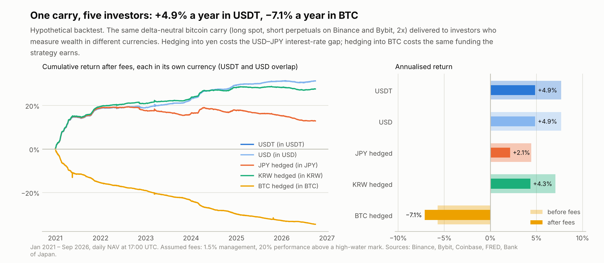

## Question

A market-neutral bitcoin carry strategy earns its return in USDT: it holds spot BTC, shorts
USDT-margined perpetual futures against it, and collects the funding that leveraged longs pay. Its
investors do not all measure wealth in USDT. A Japanese institution measures in yen, a Korean one in
won, and a crypto-native holder in bitcoin. Funds commonly offer the same strategy in several share
classes for this reason: USD, stablecoin, currency-hedged and coin-denominated. This repository asks,
with public data only:

> **When the same market-neutral carry is sold as USDT, USD, yen-hedged, won-hedged and bitcoin share
> classes, how different are the returns and risks each investor receives, and where does each
> difference come from?**

## TL;DR

1. **The master earned 7.7% a year before fees, and most of its excess over cash came in 2021.**
   - Long spot BTC, short perpetuals on Binance and Bybit at 2x, January 2021 to September 2026.
   - Daily volatility 1.0% a year, worst drawdown −0.6%, 89% of weeks positive, beta to BTC 0.00.
   - Return minus SOFR, in points: +25.4 in 2021, +0.3 in 2022 and 2023, +2.9 in 2024, −1.1 in 2025
     and −1.6 in 2026 to date.
   - Sharpe ratio against SOFR 0.54 (95% interval 0.18 to 0.89), from monthly excess returns adjusted for
     their autocorrelation (0.71 at lag 1). Daily returns are autocorrelated too (about 0.5 at lags
     1–5), so the usual daily figure, 4.3, overstates risk-adjusted return several times.
2. **After assumed fees (1.5% management, 20% performance above a high-water mark), the classes earn:**

   | USDT | USD | KRW hedged | JPY hedged | BTC hedged |
   | --- | --- | --- | --- | --- |
   | +4.9% | +4.9% | +4.3% | +2.1% | **−7.1%** (in BTC) |

3. **The yen investor earns less only in absolute terms.**
   - The monthly forward hedge costs the dollar–yen interest gap: 3.2 points a year on average, and
     5.2, 5.3 and 4.0 points in 2023, 2024 and 2025 (2.2 in 2026 to date).
   - Before fees, every fiat class earns about the same mean excess over its own cash rate, 4.1–4.2% a year,
     with the same Sharpe ratio, 0.53–0.54. Hedging changes the currency, not the excess return.
   - In yen, the class lost money after fees in 2022, 2023, 2025 and 2026 to date.
   - The won hedge cost 0.6 points a year, and was a gain in 2021 and 2022, when Korean rates were
     higher.
4. **For a bitcoin holder, the basis carry is not a yield.**
   - In the base case the class stays long BTC through a USDT-margined long perpetual on all of its
     NAV, not netted against the master's short, and keeps a third of NAV in USDT as its margin. The
     hedge pays the same funding the master earns, on all of NAV, while only two thirds is invested.
   - Algebra predicts −5.6% a year before fees: (1 − m) × master return − funding. The backtest gives
     −5.7%, and the class lost BTC in every calendar year.
   - Other constructions lose less but still lose: with the hedge margin held in BTC, −2.3%; with the
     hedge netted against the master's short, −3.4%; with the quarterly future as the hedge, −3.5%
     against −5.2% for the perpetual over the same window.
   - The carry a BTC holder can earn without selling BTC (short perp against long quarterly) averaged
     +0.5% a year.
5. **Counterparty losses depend on the class currency.**
   - About a third of master NAV sits as margin at the two exchanges.
   - FTX repaid its non-US customers (class 5A) in dollars at petition-date prices, in instalments:
     72% of the claim on 30 May 2025, 78% by 30 September 2025 and 96% by 31 March 2026.
   - Valued on each payment date, that is 82% of what the claim would have grown to in the master. Had
     Binance failed on FTX's petition date with the same recovery, the USD and USDT classes would have
     lost 3.0% of NAV.
   - The same payments bought back 17% of the coins. Because the BTC class also keeps its hedge margin
     at the venue, it would have lost 37.0% of NAV.
6. **The carry moves in regimes.**
   - Funding: 80% a year in early 2021, then 15%, 5%, 20% around the spot ETFs, and 5% since
     April 2024. Break dates are estimated, not assumed.
   - Before FTX, the offshore quarterly basis ran 9 points a year above CME (the mean of daily
     differences). The gap has since closed.
   - Since the ETFs, a CME basis trade has earned at least as much per unit of capital (5.3–6.1%) as
     the offshore carry (4.6–5.2%), before the fees and tracking of whatever regulated long leg is used.
7. **Options give a BTC holder a modest yield at best.** In [chapter 2](vol_overlay/README.md), with
   Deribit option trades priced on each expiry's forward:
   - BTC options were priced 8.9 vol points above the volatility that followed, but only 3.8 points at
     the money.
   - Monthly 25-delta covered calls earned +2.0% a year in BTC before fees and −1.1% after.
   - A delta-hedged short straddle earned +6.1% a year on notional, with 12% volatility, and lost
     money in each of the four stress months listed in `config.yaml` (chosen by hand).
8. **Leverage is a trade-off between carry and liquidation risk; the worst days in the sample were
   survivable.**
   - The base case uses 2x, chosen in-sample. With the engine's 4-hour top-up, the margin model puts
     its annual probability of a liquidation at 1.1% from target margin and 3.9% from the edge of the
     rebalancing band, where the engine lets margin sit. That is above a 1% reference level; the
     band-edge figure comes from the fitted tail, with no observed episode since 2018.
   - At 1x, the master would have earned 5.8% a year before fees instead of 7.7%, and the USD class
     3.3% after fees instead of 4.9%.
   - On 10 October 2025, BTC fell 12.6% in 80 minutes and the hedged book moved between −22 and
     +34 basis points of NAV.
   - Had a venue auto-deleveraged the short at any minute of that cascade, the worst outcome was −2.4%
     of NAV.

## Data

| Series | Source | Window | Notes |
| --- | --- | --- | --- |
| Spot BTCUSDT, hourly | Binance public archive (`data.binance.vision`), SHA-256 checked | 2018 – Sep 2026 | from 2018 for the liquidation model; daily files where a monthly file is not yet published |
| USDT-margined perpetual and quarterlies, hourly; funding | Binance archive | Dec 2020 – Sep 2026 | quarterlies from `BTCUSDT_210326`; every roll has the next contract priced |
| Linear perpetual, hourly; funding | Bybit v5 API | Dec 2020 – Sep 2026 | |
| Funding | Hyperliquid API | May 2023 – Sep 2026 | comparison only |
| BTC-USD hourly, USDT-USD daily | Coinbase Exchange API | Dec 2020 / May 2021 – Sep 2026 | USDT assumed at par for the first 123 days |
| CME bitcoin futures, front month, daily close | Yahoo Finance `BTC=F` | Dec 2020 – Sep 2026 | Yahoo's daily close. Against Coinbase spot, the basis is smoothest with spot at 15:00 Chicago, the CME settlement time (daily-change s.d. 0.24%, against 1.0–1.1% an hour either side), so the close is treated as a 15:00 price. The expiry calendar (last Friday of the month) is rebuilt in code |
| SOFR, USD/JPY, USD/KRW, KRW 3-month rate | FRED | | KRW rate monthly (CD 91-day needs an ECOS key) |
| Uncollateralised overnight call rate (TONA), daily | Bank of Japan time-series API | | |
| One-minute bars, 10 Oct 2025 | Binance archive, Bybit API | | stress replay |
| USDe circulating supply | DefiLlama | Dec 2023 – | crowding indicator |
| DVOL, delivery prices, option trades | Deribit (`history.deribit.com` for trades) | Mar 2021 – Sep 2026 | chapter 2; 176,447 trades around 67 monthly expiries |
| Fees, funding formulas, FTX distributions | exchange fee and funding pages, FTX Recovery Trust press releases | retrieved 2026-10-04/05 | sources in `config.yaml` and [References](#references) |

Everything is stored in UTC. Each hourly row covers (t − 1h, t]. Daily NAVs are struck at 17:00 UTC.
That is New York noon in winter and 13:00 in summer, so FRED's noon FX rates are never later than the
NAV they value. Coinbase's daily USDT-USD candle closes at 24:00 UTC, so each close is used from the
next day's NAV.

## Method

### The master strategy

A long position of Q BTC in spot, held at a custodian, is hedged by short perpetuals n_v on each venue
v (Σ n_v = Q), with margin equity E_v. NAV = cash + Q·S + Σ E_v (USDT). Every hour the change in NAV
splits exactly into three parts:

$$\Delta NAV_t = \underbrace{\sum_v n_v f_{v,t} F_{v,t}}_{\text{funding}} + \underbrace{\sum_v n_v\big[(F_{v,t-1}-S_{t-1})-(F_{v,t}-S_t)\big]}_{\text{basis convergence}} - \underbrace{C_t}_{\text{costs}}$$

- The engine (`src/engine.py`) checks this identity every hour. The largest error is 6×10⁻⁸ USDT on a
  $100m book.
- Rebalancing resets each leg to its target weight with margin E_v = n_v F_v / L. It runs every
  Monday 00:00 UTC, and four hours after any leg's margin ratio leaves 1/L ± 25%.
- A leg whose equity falls below maintenance at the hour's high is flagged as a liquidation. The
  check uses the last-price high, which is conservative: venues liquidate on a mark price that
  follows the index.
- Costs: spot taker 0.045% (Binance VIP 3 with BNB), perpetual taker 0.03% (assumed institutional
  tier), and a 0.5bp half-spread on each.
- Dated futures enter the same engine as legs that roll: at 08:00 UTC on expiry day the expiring
  contract settles to spot and the next quarter is opened. Their carry arrives as convergence.
- **Choosing the master.** Two candidates were run: the perp carry above, and a quarterly carry (long
  spot, short Binance's quarterly future, rolled at each expiry). The rule in `config.yaml` picks the
  higher Sharpe ratio after costs over the window both candidates cover (from 4 February 2021).
- **Return attribution.** Each hour's funding, convergence and costs, as a share of the previous
  hour's NAV, are scaled by ln(1 + r)/r (Carino 1999), so that the three parts add up exactly to the
  annualised log return. The compounded annual return is shown next to it.

### Leverage

A short with margin ratio e (margin / notional) and maintenance margin m (2.5%) is liquidated by a
price rise of (e − m)/(1 + m) before margin is topped up. The engine does not hold e at the target
1/L: it tops up only when e leaves the band 1/L ± 25%, four hours after the breach. Margin can
therefore sit just inside the lower band edge for up to a week, and the threshold that matters is

$$x^*(L) = \frac{0.75/L - m}{1+m}$$

- The annual probability of such a rise within the top-up lag (1, 4, 24 or 72 hours; 4 is the
  engine's own) uses hourly BTC since 2018, as the larger of two estimates:
  - declustered empirical episodes, with an exact Poisson interval;
  - a generalised Pareto tail with an extremal-index correction.
- A rise within T hours is also a rise within any longer window, so each estimate is made
  non-decreasing in the lag.
- The same calculation from the target margin 1/L is reported for comparison. The estimates depend on
  the threshold, the tail model and the sample; they are a guide to relative risk, not a guarantee.
- Leverage is set in `config.yaml` as a trade-off, not derived from a limit: the 1% a year in
  `config.yaml` is a reference line for reporting, not a constraint the base case is built to meet.

### Share classes

Each class has a daily NAV in its own currency (`src/share_classes.py`):

| Class | Construction |
| --- | --- |
| USDT | the master's NAV |
| USD | the master's NAV × the previous day's USDT-USD close. A long-spot / short USDT-margined perp book is a synthetic USDT deposit, so the whole book carries the peg |
| JPY hedged, KRW hedged | master units worth A USD, plus a one-month forward selling A USD, rolled at each month start and marked daily (below) |
| BTC hedged | base case: a USDT-margined long BTC perpetual (or quarterly) equal to the class NAV in BTC, rebalanced daily and not netted against the master, with a third of NAV kept in USDT as its margin and not invested. Variants: margin held in BTC; hedge netted against the master's short |

The forward is priced by covered interest parity, with an optional cross-currency basis b (0 in the
base case, −30bp as a sensitivity):

$$\frac{F_t(T)}{X_t} = \frac{1+(i_{ccy}+b)\,\tau_{ccy}}{1+i_{USD}\,\tau_{USD}}, \qquad NAV_t = A_t X_t + \frac{N\,(K - F_t(T))}{1+i_{ccy}\tau_{ccy}}$$

The BTC class's NAV in BTC follows

$$W_t = A_t + C_t, \qquad C_t \mathrel{+}= h_t \cdot \text{hedge P\&L per BTC}_t, \qquad NAV^{BTC}_t = W_t / S_t$$

- **Fees, in each class's own currency.** The management fee is accrued daily (ACT/365). The
  performance fee is accrued daily as a liability on gains above the high-water mark and crystallised
  at quarter ends. Each class is one investor with no flows, so no equalisation is needed.
- **Excess returns** use each currency's own short rate: SOFR for USD and USDT, TONA for yen, the
  3-month rate for won, and zero for BTC.
- **Sharpe ratios** are computed from monthly excess returns and annualised with Lo's (2002)
  correction for serial correlation, η(12) = 12 / √(12 + 2 Σ_k (12 − k) ρ_k). The 95% interval uses
  Lo's non-iid standard error (delta method with a Newey–West covariance), scaled by η, which is
  treated as known. The Sharpe ratio is therefore the annual excess return divided by the volatility
  of annual excess returns implied by the monthly ones, not by the daily volatility shown next to it.

### The carry, counterparty risk and stress

- **Carry measures.**
  - Funding is annualised from 8-hourly settlements.
  - Quarterly and CME basis are annualised to each contract's expiry. Days within a week of expiry,
    and the first trading day after each CME expiry (when the continuous series switches contract),
    are excluded.
  - Regimes are mean shifts in weekly funding, found by Bai–Perron dynamic programming (minimum
    13 weeks per segment, number of breaks by BIC).
- **Counterparty.**
  - Only perp margin is at the venues; spot is assumed held off-exchange.
  - Expected loss per year is PD × LGD × the venue's share of NAV, on scenario grids.
  - A failure on FTX's petition date is replayed with FTX's actual payments to class 5A customers.
    Each instalment is valued on its own payment date in each class's unit: master units for the USD
    and USDT classes, coins for the BTC class. Whatever was unpaid at the last distribution counts as
    lost.
- **10 October 2025.** One-minute bars replay the book as at 20:00 UTC: the mark-to-market path, the
  lowest margin ratio, and auto-deleveraging (ADL). For ADL, the short is assumed closed at each
  minute of the cascade and re-established 5–240 minutes later. The cascade runs from the first minute
  spot traded 5% below its 20:00 open to the minute of each perpetual's low (8 minutes on both venues).
  Because it ends at the low, every re-hedge happens after the bottom, which favours slow re-hedges.

## Results

### 1. The master

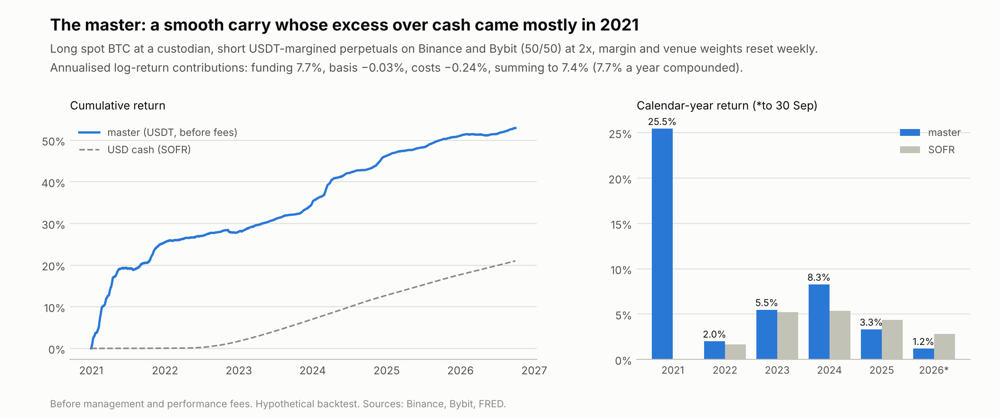

| Candidate (common window from 4 Feb 2021, 2x) | Return | Daily volatility | Sharpe vs SOFR | Max drawdown |
| --- | --- | --- | --- | --- |
| **Perp carry, Binance + Bybit** (chosen) | 6.9% | 0.9% | 0.53 | −0.6% |
| Quarterly carry, Binance | 4.2% | 3.0% | 0.26 | −4.2% |

Over the same window funding contributed 7.0% a year to the perp book's log return. The quarterly
book locked in basis worth 6.0% of NAV a year at its rolls, but realised only 84% of it.

- **Why carry was lost.** The basis widens when BTC rallies, which is exactly when the short leg needs
  margin and the book must buy futures back. It narrows in sell-offs, when the book adds shorts.
  Resizing a dated-future hedge therefore buys the basis high and sells it low.
- **Why perps avoid this.** A perpetual pays the current funding rate every 8 hours, so resizing it
  costs only fees.
- **Why the quarterly book is more volatile.** Its NAV moves with the quarterly basis, whose daily
  changes had 11.7 times the standard deviation of the perpetual's.

**The chosen master, January 2021 – September 2026:**

| Year | 2021 | 2022 | 2023 | 2024 | 2025 | 2026 (to Sep) |
| --- | --- | --- | --- | --- | --- | --- |
| Master, before fees | 25.5% | 2.0% | 5.5% | 8.3% | 3.3% | 1.2% |
| SOFR | 0.0% | 1.7% | 5.2% | 5.4% | 4.4% | 2.8% |
| Excess, points | +25.4 | +0.3 | +0.3 | +2.9 | −1.1 | −1.6 |

- **Risk:** 7.7% a year with daily volatility of 1.0% a year. Worst drawdown −0.6% (15 December
  2022), worst day −0.16% (10 November 2022, FTX).
- **Sharpe ratio:** 0.54 (95% interval 0.18 to 0.89). Because the excess over SOFR moves in regimes, the
  volatility of annual excess returns implied by the monthly ones is 7.7%, far above the daily figure.
  The same monthly returns treated as independent would give 1.11; daily returns treated as
  independent would give 4.26.
- **Where the return came from:** funding 7.7%, basis −0.03% and costs −0.24% a year. These add up to
  the annualised log return of 7.4%, which is 7.7% a year compounded.
- **Fees:** public regular-tier fees instead of institutional ones would cut the return to 7.5%.
- **Leverage:** 1x earns 5.8%, 2x 7.7% and 3x 8.6%. 3x is flagged once for liquidation, on Binance in
  the hour to 02:00 UTC on 26 July 2021. In that hour Binance's perpetual traded up to $48,169, 31%
  above the hour's open, while Bybit's perpetual and Binance spot peaked 8.8% and 8.3% above theirs.
  The flag uses the last-price high; Binance liquidates on a mark price that follows the index, so a
  real account might have survived this wick. The engine only flags liquidations and keeps the
  position, so the 3x return assumes the account was not liquidated; had it been, that leg's margin
  would have been lost.

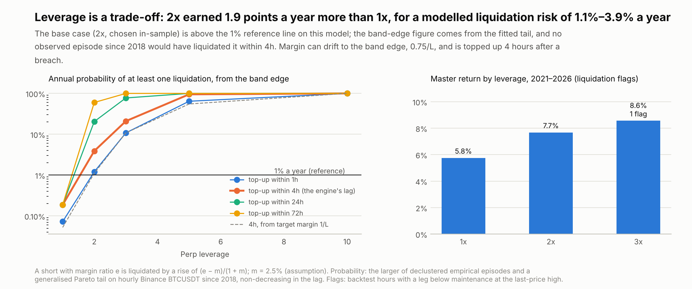

| Annual probability of at least one liquidation, from the band edge | 1x | 2x | 3x | 5x |
| --- | --- | --- | --- | --- |
| Liquidating rise x*(L) | 71% | 34% | 22% | 12% |
| Top-up within 1 hour | 0.07% | 1.2% | 11% | 64% |
| **Top-up within 4 hours (the engine's lag)** | 0.19% | **3.9%** | 21% | 95% |
| Top-up within 24 hours | 0.19% | 20% | 77% | 100% |
| Top-up within 72 hours | 0.19% | 60% | 100% | 100% |
| *From target margin 1/L, 4 hours* | *0.05%* | *1.1%* | *11%* | *55%* |

**The trade-off, with the engine's 4-hour top-up:**

| Leverage | Master return, before fees | USD class, after fees | Sharpe vs SOFR | Liquidation probability a year, from target margin | … from the band edge | Backtest liquidation flags |
| --- | --- | --- | --- | --- | --- | --- |
| 1x | 5.8% | 3.3% | 0.38 | 0.05% | 0.19% | 0 |
| **2x (base case)** | **7.7%** | **4.9%** | **0.54** | **1.1%** | **3.9%** | **0** |
| 3x | 8.6%* | 5.6%* | 0.59 | 11% | 21% | 1 |

\* Assumes the flagged hour did not liquidate the account (see above).

- **The base case accepts a modelled risk above 1% a year for 1.9 points a year of extra return.** The
  2x probability rests on the tail model: no empirical episode since 2018 had BTC rise far enough
  within 4 hours to liquidate a 2x short from the band edge; 3.9% comes from the fitted tail. With a
  24-hour top-up there were 2 such episodes, and with 72 hours 8.
- **What would change it.** Faster top-ups or a narrower band lower the risk; a long weekend with a
  stuck transfer raises it sharply. An investor who wants the modelled risk under 1% a year would run
  1x and give up the difference above.

### 2. Five classes, one strategy

| After fees | USDT | USD | JPY hedged | KRW hedged | BTC hedged |
| --- | --- | --- | --- | --- | --- |
| Return a year (own currency) | 4.9% | 4.9% | 2.1% | 4.3% | −7.1% |
| Mean excess over own cash rate (12 × monthly mean; the Sharpe numerator) | 1.5% | 1.5% | 2.0% | 1.6% | −7.3% |
| Daily volatility, annualised | 0.8% | 1.0% | 1.0% | 1.0% | 2.0% |
| Sharpe (95% interval) | 0.23 (−0.29 to 0.74) | 0.22 (−0.29 to 0.74) | 0.31 (−0.18 to 0.79) | 0.25 (−0.25 to 0.75) | −1.84 (−2.41 to −1.27) |
| Max drawdown | −0.7% | −0.7% | −5.4% | −1.4% | −34.6% |
| Positive months | 81% | 83% | 38% | 70% | 0% |
| Fees paid a year | 2.6% | 2.6% | 2.2% | 2.5% | 1.5% |
| **Before fees** | 7.7% | 7.7% | 4.4% | 7.0% | −5.7% |
| … mean excess over own cash rate | 4.1% | 4.1% | 4.2% | 4.2% | −5.8% |
| … Sharpe | 0.54 | 0.53 | 0.54 | 0.54 | −1.46 |

- **USD vs USDT.** The peg cost 0.01 points a year. Its lowest daily close was 0.996, on 11 May 2022
  (Terra). The USD class has higher daily volatility because the daily USDT-USD close moves by a few
  basis points from day to day.
- **Fees** take 2.2–2.6 points a year from the fiat classes. The performance fee is charged on
  nominal gains, so it takes less from the yen class.
- **Mean excess** is the arithmetic mean of monthly excess returns times 12, the numerator of the
  Sharpe ratio. It is not the compounded return minus the compounded cash rate, so it does not equal
  the difference of the rows above it.
- **Sharpe intervals** after fees include zero for every fiat class: with one strong year and five
  close to cash, the sample cannot show that the excess over cash after fees was reliably positive.

### 3. What each hedge costs

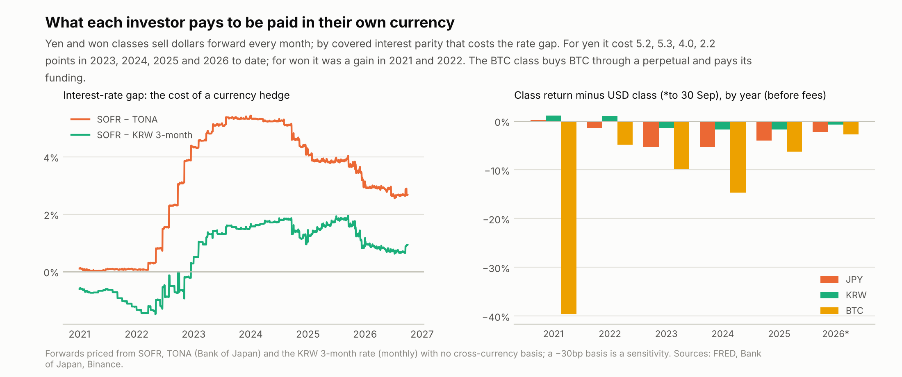

| Class return minus the USD class, before fees, points | 2021 | 2022 | 2023 | 2024 | 2025 | 2026 (to Sep) |
| --- | --- | --- | --- | --- | --- | --- |
| JPY hedged | +0.3 | −1.4 | −5.2 | −5.3 | −4.0 | −2.2 |
| KRW hedged | +1.2 | +1.1 | −1.4 | −1.7 | −1.7 | −0.7 |
| BTC hedged (perp) | −39.6 | −4.8 | −9.8 | −14.7 | −6.3 | −2.8 |

- **The currency hedge is the interest-rate gap.** Over the sample SOFR averaged 3.3%, TONA 0.2% and
  the won 3-month rate 2.7%. A −30bp cross-currency basis lowers the yen class from 4.4% to 4.1% before
  fees; the won class goes from 7.0% to 6.7%.
- **The BTC hedge cost is the funding,** which in 2021 averaged 31–38% a year.

### 4. Why the BTC class loses BTC

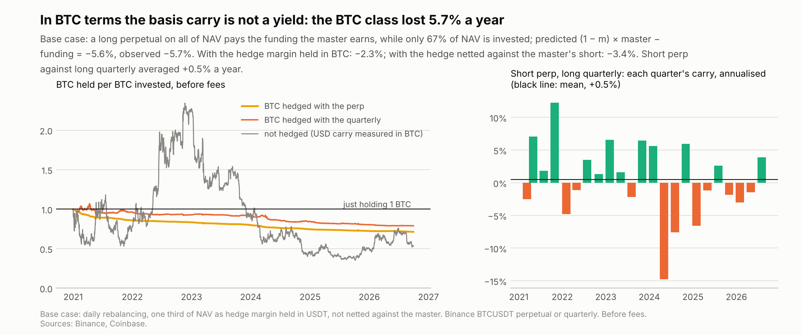

In the base case the class keeps its investors long BTC by holding a long BTC perpetual equal to its
NAV, margined in USDT and not netted against the master's short. That hedge pays funding f on all of
NAV. Meanwhile only (1 − m) of NAV, with m = 1/3 kept as hedge margin, earns the master's return r,
which is itself funding × L/(L + 1) minus costs:

$$r_{BTC} \approx (1-m)\,r - f = 0.67 \times 7.7\% - 10.8\% = -5.6\% \text{ a year (observed } -5.7\%)$$

| Construction, before fees | Algebra | Predicted | Backtest |
| --- | --- | --- | --- |
| Base case: USDT margin, not netted | (1 − m) r − f | −5.6% | −5.7% |
| Margin held in BTC (coin-margined) | (1 − m)(r − f) | −2.1% | −2.3% |
| Netted against the master's short, no separate margin | r − f | −3.1% | −3.4% |

- **Below zero for any positive funding.** Netted with no margin, the class still earns about
  −f / (L + 1) = −3.6% before costs. Holding the margin in BTC loses less only because a third of NAV
  then earns nothing in BTC terms instead of paying funding.
- **Hedge instrument.** Hedging with the quarterly future, which pays the term basis rather than
  funding, lost 3.5% a year instead of 5.2% (since February 2021).
- **No hedge is worse.** Leaving the class unhedged (a USD carry measured in BTC) lost 10.4% a year in
  BTC terms while BTC itself rose 20.1% a year in dollars.
- **What a BTC holder can earn without selling BTC.** Short perp, long quarterly, with BTC as
  collateral, earned +0.5% a year on average over 23 quarters. It was positive in 52% of them, ranging
  from −14.8% to +12.3% annualised.

### 5. The carry: regimes, venues and CME

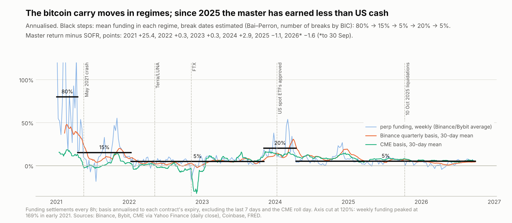

| Funding received by a short, annualised | 2021 | 2022 | 2023 | 2024 | 2025 | 2026 |
| --- | --- | --- | --- | --- | --- | --- |
| Binance | 30.6% | 4.2% | 7.9% | 11.9% | 5.1% | 2.9% |
| Bybit | 38.3% | 2.9% | 8.9% | 12.0% | 5.1% | 2.4% |
| Hyperliquid (from May 2023) | | | 13.5% | 24.1% | 10.6% | 5.1% |

**Regimes.** The breaks found, with BIC choosing four, and mean funding in each:

| Regime | Annualised funding |
| --- | --- |
| Jan – Apr 2021 | 80% |
| Apr 2021 – Jan 2022 | 15% |
| Jan 2022 – Nov 2023 | 5% |
| Nov 2023 – Apr 2024 | 20% |
| Apr 2024 – Sep 2026 | 5% |

- The last break sits near the spot-ETF period and the growth of USDe, a synthetic dollar whose
  backing shorts perpetuals. USDe supply grew from $0.9bn in March 2024 to a $14.8bn peak in
  September 2025, and is $4.9bn now. Weekly funding correlates −0.43 with its level and −0.20 with its
  changes. Consistent with more shorts competing for the carry; not tested.
- **Hyperliquid paid shorts 6.7 points a year more than Binance since May 2023.** Both venues use the
  same funding formula, with the same interest term of 0.01% per 8 hours (about 11% a year), so the
  gap comes from the premium of Hyperliquid's perpetual over its index; it is not decomposed here.
  Hyperliquid is used for comparison only, not in the master.

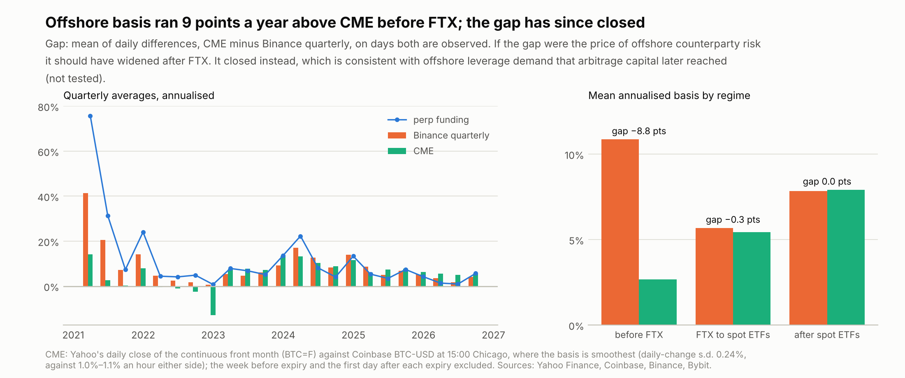

| Mean, annualised | Before FTX | FTX to spot ETFs | After spot ETFs |
| --- | --- | --- | --- |
| Perp funding (Binance) | 18.7% | 7.2% | 6.9% |
| Binance quarterly basis | 10.9% | 5.7% | 7.8% |
| CME basis | 2.7% | 5.4% | 7.9% |
| Gap, CME minus quarterly (mean of daily differences), points | −8.8 | −0.3 | 0.0 |
| Return on capital: perp carry at 2x | 12.5% | 4.8% | 4.6% |
| Return on capital: quarterly carry at 2x | 7.2% | 3.8% | 5.2% |
| Return on capital: CME basis, 30–50% margin | 1.8–2.1% | 3.6–4.2% | 5.3–6.1% |

- **The gap closed.** If the offshore premium over CME were mainly a price for counterparty risk, it
  should have widened after FTX. It closed instead. That is consistent with offshore leverage demand
  that arbitrage capital later reached; not tested.
- **The regulated route has paid at least as much per unit of capital since the ETFs,** without
  exchange counterparty risk. The comparison leaves out the cost of the regulated long leg (ETF fees,
  or the ETF's tracking of spot), so it does not show that the CME trade earned more after costs.

### 6. Counterparty risk

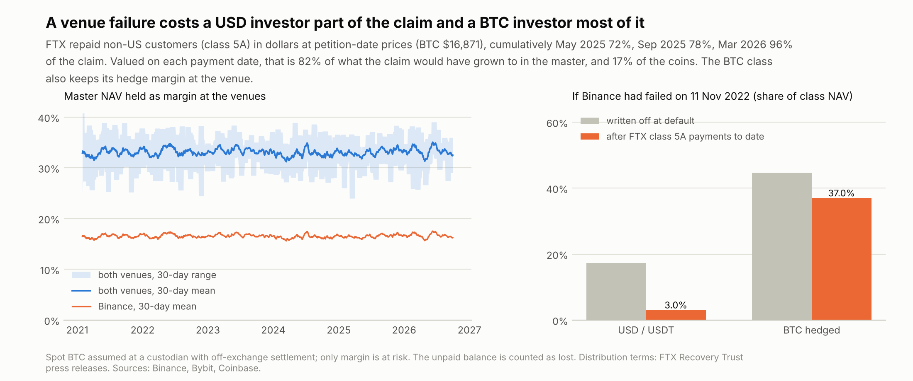

- **Exposure.** Margin at the venues averages 16.5% of master NAV each (20.4% at most). On FTX's
  petition date it was 17.3% each.
- **Expected loss** at a 3% annual default probability per venue and 50% loss given default is
  0.5% of NAV a year. A single failure at that loss rate costs 8.3% of NAV at mean exposure and 10.2%
  at peak exposure, about a year of the master's return in its best year since 2022 (8.3% in 2024).
- **FTX's payments to class 5A (non-US customers).** Claims were fixed in dollars at petition-date
  prices (BTC $16,871). The first distribution, in February 2025, paid only the convenience class
  (claims under $50,000), which in time received 120%. Class 5A was paid:

  | Payment date | Cumulative share of the claim | BTC-USD that day | Master (USD class) since the petition |
  | --- | --- | --- | --- |
  | 30 May 2025 | 72% | $103,902 | ×1.159 |
  | 30 Sep 2025 | 78% | $112,855 | ×1.176 |
  | 31 Mar 2026 | 96% | $67,603 | ×1.184 |

| If Binance had failed on 11 Nov 2022 | USD / USDT classes | BTC class |
| --- | --- | --- |
| NAV at the venue (written off at once) | 17.3% | 44.6% (includes its hedge margin) |
| Recovery, in the class's own unit, each payment valued on its date | 82% of the claim's value in master units | 17% of the coins |
| Net loss after recovery | 3.0% | 37.0% |

The USD figure compares each payment with what the claim would have been worth had it stayed in the
master; nominally the claim was repaid at 96 cents per dollar, 2.5 to 3.4 years after the petition.

### 7. 10 October 2025

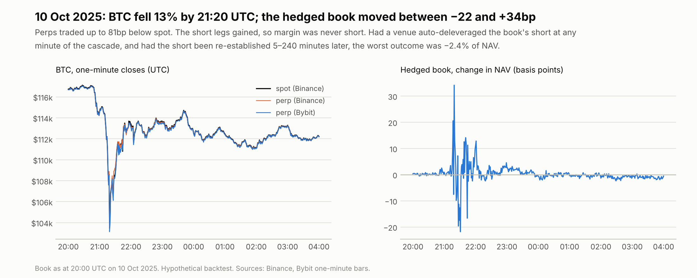

- **The fall.** BTC fell 12.6% from 20:00 UTC to the 21:20 low ($102,000) and closed the window at
  $112,222.
- **The hedge held.** Perps traded 51–81bp below spot at the worst minute and up to 77bp above. The
  hedged book's mark-to-market moved between −22bp and +34bp of NAV.
- **Margin was never short.** The shorts gained in the crash, so the lowest margin ratio was 58%
  against 2.5% maintenance.
- **ADL scenarios.** If a venue had auto-deleveraged the short during the cascade and the short had
  been re-established later, the outcome relative to staying hedged would have been:

  | Re-established after | 5 min | 15 min | 60 min | 240 min |
  | --- | --- | --- | --- | --- |
  | Worst | −2.4% | −1.1% | +0.4% | −0.1% |
  | Best | +1.4% | +2.1% | +2.7% | +2.3% |

  Each figure is the more extreme of the two venues, as a share of NAV. The price rebounded within
  the hour, so a slow re-hedge would have helped. In a crash that keeps falling the sign flips.

### 8. Chapter 2: a BTC yield from options

A BTC class needs a yield that is not the basis.
[`vol_overlay/README.md`](vol_overlay/README.md) tests the candidate yields with Deribit's option
trades: the volatility risk premium, BTC-denominated covered calls at 25 and 10 delta, and a
delta-hedged short straddle.

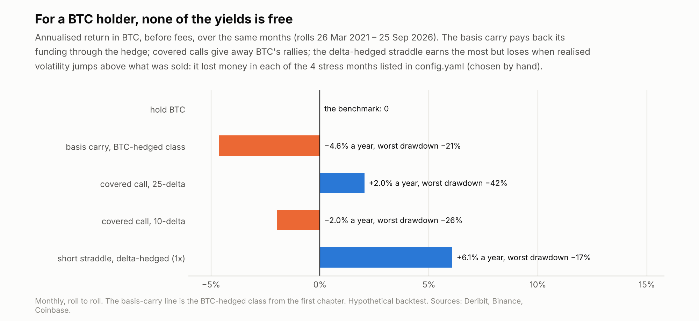

### 9. Factsheets

One A4 page per class, generated by the pipeline in `reports/` and marked as a hypothetical backtest:
[USDT](reports/factsheet_usdt.pdf) · [USD](reports/factsheet_usd.pdf) ·
[JPY hedged](reports/factsheet_jpy_hedged.pdf) · [KRW hedged](reports/factsheet_krw_hedged.pdf) ·
[BTC hedged](reports/factsheet_btc_hedged.pdf), plus the
[BTC covered-call class](reports/factsheet_btc_covered_call.pdf) from chapter 2. Each shows:

- the class's own figures in its own currency;
- a year × month return grid;
- the assumed terms;
- the strategy's risks, each computed in the run;
- a table comparing all five classes.

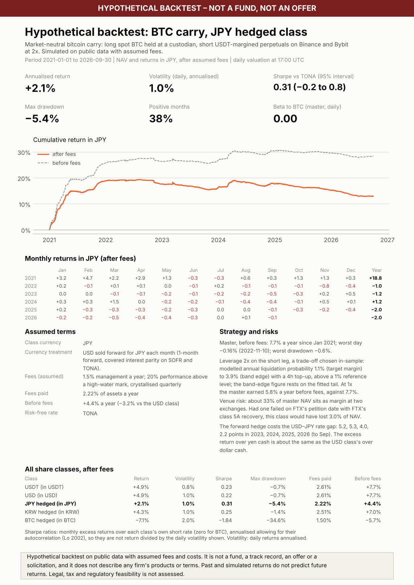

## Discussion

- **Why does a yen investor earn less from the same strategy?**
  - They don't, relative to the yen they would otherwise hold. Covered interest parity makes the
    hedge cost the dollar–yen rate gap.
  - Before fees, the class's mean excess over yen cash (4.2%) matches the USD class's excess over dollar
    cash (4.1%), with the same Sharpe ratio.
  - What changes is the absolute number. With yen rates near zero and dollar rates at 5%, the class
    returned 4.4% before fees and 2.1% after.
  - A yen allocator comparing this strategy with a domestic alternative should compare excess returns.
- **What is the BTC class's hidden risk?**
  - **Its return.** A basis carry is the price of dollar-funded BTC leverage. A BTC holder who wants
    to stay long BTC pays that price through the hedge, so the carry does not reach them, whichever
    way the hedge is margined.
  - **Its counterparty exposure.** The BTC class also has more counterparty exposure than any other
    class, and dollar-denominated claims recover badly in coins when BTC rises during a bankruptcy.
  - **What a BTC class needs instead.** Strategies whose return is not the basis: cross-venue
    spreads, the perp-quarterly spread, lending, or option premium. Chapter 2 measures the last.
    Covered calls returned +2.0% a year in BTC before fees; a hedged short straddle +6.1%, with tail
    risk.
- **If CME's basis is below offshore funding, what is the difference the price of?**
  - In 2021–22 the offshore premium was large and CME was cheaper. Since FTX and the ETFs the two have
    converged.
  - The evidence fits segmented leverage demand better than a counterparty-risk premium, which should
    have widened after FTX. Not tested.
  - For an institution, the regulated route has paid at least as much per unit of capital since 2024,
    before the cost of its long leg.
- **How good is the master, risk-adjusted?** Less than its smooth NAV suggests. Its excess over cash
  depends on the funding regime: outside 2021 and 2024 it was within 1.6 points of cash each year.
  An autocorrelation-adjusted Sharpe ratio of about 0.5 before fees is the honest summary.

## Data checks (`data/processed/validation.json`)

- **Coverage.** Of 50,375 sample hours:
  - Binance spot has 14 missing hours and Coinbase BTC-USD 13, all forward-filled;
  - Binance and Bybit perps have none.
- **Funding.** Each venue has all 6,296 expected 8-hourly settlements. Binance and Bybit correlate
  0.73, with a mean absolute difference of 0.8bp per settlement.
- **Quarterlies.** All 23 rolls had the next contract priced. One hour before settlement the expiring
  contract sat a median 4.9bp (at most 23bp) from spot, which supports settling to spot.
- **Spot sources.** Binance BTC/USDT against Coinbase BTC/USD: median −0.9bp (1st–99th percentile
  −23 to +17bp).
- **CME.** 1,064 of 1,470 days were used; 406 fell within a week of expiry, on the first day after an
  expiry, or had no Coinbase price at 15:00 Chicago.
- **Forward-fills.** FRED FX ends 25 September, so the last 5 days are forward-filled. The KRW rate
  is monthly and forward-filled.
- **Tests.** 81 unit tests, plus `tests/mutation_check.py`, which applies 41 deliberate bugs (28 in
  this chapter, 13 in chapter 2) and exits with an error if the suite misses any. It catches all 41.

## Limitations

- **Costs and terms are assumptions.** Fees, spreads, maintenance margins and fund terms are assumed;
  fees use the public schedules of October 2026 for every year. Market impact, and the capacity of the
  strategy, are not modelled.
- **Several choices were made with the sample in view:** the 2x leverage, the 25% rebalancing band,
  the choice of master (the selection rule was applied to the same data it reports on), the four
  stress months in chapter 2, and the skew used in chapter 2's fallback months. None was optimised,
  but none was fixed on data the results do not use.
- **The hedges are idealised.**
  - The yen and won forwards are priced from overnight rates and covered interest parity; in practice
    there are term rates, a cross-currency basis (shown only as a sensitivity), bank credit lines and
    the won's offshore NDF market.
  - The KRW rate is monthly.
- **Operations are idealised.** Off-exchange custody, transfers between venues, and the time it takes
  to post margin are idealised. Margin is assumed to arrive within four hours of a breach.
- **Risk statistics are estimates.** The liquidation probabilities depend on the tail model. The Sharpe
  intervals treat Lo's correction factor as known and rest on 69 monthly observations, most of whose
  excess return came from one year.
- **Counterparty risk is scenario-based.** Default probabilities are scenarios, and FTX's recovery is
  one data point; any later payment to class 5A is not included. Auto-deleveraging is replayed for one
  day only.
- **Data timing.** Yahoo's CME close is treated as a 15:00 Chicago price on the evidence above, not
  checked against CME's published settlements. The USDT-USD price used for
  each NAV is the previous day's close.
- **The investor model is simple.** Each class is a single investor with no subscriptions or
  redemptions, so equalisation and dilution are not modelled.
- **Five years of one market.** Funding regimes change; the sample includes one full boom (2021) and a
  long period near cash rates.
- **Out of scope:** legal and regulatory treatment of offshore venues for Japanese and Korean
  investors, tax, and fund structuring.

## How to run

`data/raw/` is not committed (only its `manifest.json`), so a fresh clone must collect the data first:

```bash
python -m venv .venv
.venv/bin/pip install -r requirements.txt
.venv/bin/python -m src.pipeline --collect     # fetch public data (network; series already present are skipped)
.venv/bin/python -m src.pipeline               # rebuild both chapters: every table, figure and factsheet
.venv/bin/python -m pytest -q
.venv/bin/python tests/mutation_check.py       # exits non-zero if any deliberate bug goes unnoticed
.venv/bin/python tests/check_readme.py         # every number in both READMEs against the outputs
```

`python -m src.vol_overlay.pipeline` reruns chapter 2 alone, using chapter 1's outputs. The Binance
archive files are immutable. The REST sources (Bybit, Coinbase, Hyperliquid, Deribit, FRED, Bank of
Japan, Yahoo, DefiLlama) can revise or extend history, so a fresh collection may differ slightly.
`data/raw/manifest.json` records what was fetched, and when.

```
config.yaml            every assumption; src/config.py rejects unknown or missing keys
src/clients/           Binance archive, Bybit / Hyperliquid / Coinbase / Deribit APIs, FRED, Bank of Japan, Yahoo, DefiLlama
src/collect.py         raw data with a manifest;  src/validation.py  data checks
src/engine.py          hedged-book engine with the exact P&L identity
src/strategies.py      perp carry and quarterly carry as engine inputs
src/margin.py          liquidation probability from the rebalancing-band edge
src/share_classes.py   USDT, USD, currency-hedged and BTC classes; fees and the high-water mark
src/carry.py           funding, quarterly and CME basis, calendar carry, Bai-Perron regimes
src/counterparty.py    venue exposure, expected loss, FTX's instalments by class currency
src/stress.py          10 October 2025, minute by minute
src/risk.py            statistics, including the autocorrelation-adjusted Sharpe ratio
src/plots.py, src/factsheet.py, src/pipeline.py
src/vol_overlay/       chapter 2: option pricing on the forward, volatility premium, covered calls, hedged straddle
vol_overlay/README.md  chapter 2 write-up
```

## My role and how I built this

I led this project end to end. I chose the research question for both chapters (the five share classes and the options overlay), set the scope and the assumptions in `config.yaml`, defined the checks every number has to pass, and reviewed each result before deciding the next step. I wrote the code with Claude Code as an AI pair-programmer, working under my direction.

The design decisions that shaped the results:

- **Treat the master as a USDT book,** since that is the unit its return is earned in.
- **Mark the currency forwards daily** instead of approximating the hedge cost.
- **Measure each counterparty recovery in the class's own unit** on each payment date, using FTX's actual distribution schedule.
- **Estimate regime breaks instead of assuming them.**
- **Present leverage as a trade-off** between return and liquidation risk, measured from where the margin engine actually lets margin sit.
- **Judge risk-adjusted return on monthly, autocorrelation-adjusted figures,** not the flattering daily Sharpe.

Every number computed from market data is produced by `python -m src.pipeline`; figures from other sources are cited. The tests use hand-computed values, and a mutation check confirms they fail when the code is deliberately broken.

## References

- FTX Recovery Trust, second distribution (class 5A 72%, 30 May 2025), PR Newswire:
  https://www.prnewswire.com/news-releases/ftx-recovery-trust-to-distribute-more-than-5-billion-to-creditors-in-second-distribution-on-may-30-2025-302456976.html
- FTX Recovery Trust, third distribution (class 5A 78% cumulative, 30 Sep 2025), PR Newswire:
  https://www.prnewswire.com/news-releases/ftx-recovery-trust-to-distribute-approximately-1-6-billion-to-creditors-in-third-distribution-on-september-30--2025--302561856.html
- FTX Recovery Trust, fourth distribution (class 5A 96% cumulative, 31 Mar 2026), PR Newswire:
  https://www.prnewswire.com/news-releases/ftx-recovery-trust-to-distribute-approximately-2-2-billion-to-creditors-in-fourth-distribution-on-march-31--2026--302717707.html
- FTX distributions overview (February 2025 convenience-class payments; 120% for convenience claims):
  https://www.kucoin.com/blog/ftx-ecovery · https://www.blockhead.co/2025/02/19/ftx-begins-creditor-payouts-sets-next-distribution-date/
- FTX claims valued at $16,871 per BTC: https://cointelegraph.com/news/ftx-debtors-bitcoin-claims-bankruptcy
- The 10 October 2025 liquidations: https://www.datawallet.com/crypto/october-10-crypto-crash-explained ·
  https://coinshares.com/us/insights/knowledge/billions-in-liquidations-what-happened/
- Binance fees: https://www.binance.com/en/fee/trading · https://www.binance.com/en/fee/futureFee
- Funding formulas: Binance, https://www.binance.com/en/support/faq/introduction-to-binance-futures-funding-rates-360033525031 ·
  Hyperliquid, https://hyperliquid.gitbook.io/hyperliquid-docs/trading/funding
- Binance public data archive: https://data.binance.vision
- Deribit API, options data collection and historical trades:
  https://docs.deribit.com/articles/options-data-collection-best-practices.md ·
  https://docs.deribit.com/api-reference/market-data/public-get_last_trades_by_currency_and_time.md
- Bank of Japan time-series data API: https://www.stat-search.boj.or.jp
- Bai, J. and Perron, P. (2003), "Computation and Analysis of Multiple Structural Change Models",
  *Journal of Applied Econometrics* 18(1).
- Carino, D. (1999), "Combining Attribution Effects over Time", *Journal of Performance Measurement*
  3(4).
- Lo, A. (2002), "The Statistics of Sharpe Ratios", *Financial Analysts Journal* 58(4).

## License

Code: MIT (see `LICENSE`). Raw downloads are not committed. The tables in `data/processed/` include
data derived from public sources (Binance, Bybit, Hyperliquid, Deribit, Coinbase, Yahoo Finance, FRED,
Bank of Japan) and are shared for research; each provider's terms apply to that data.
