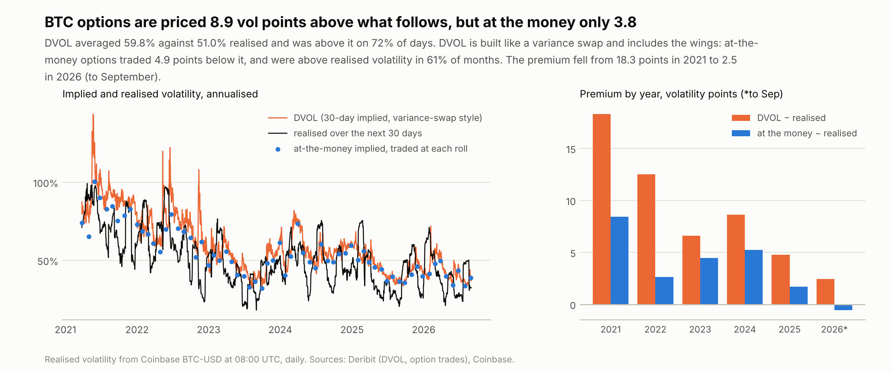
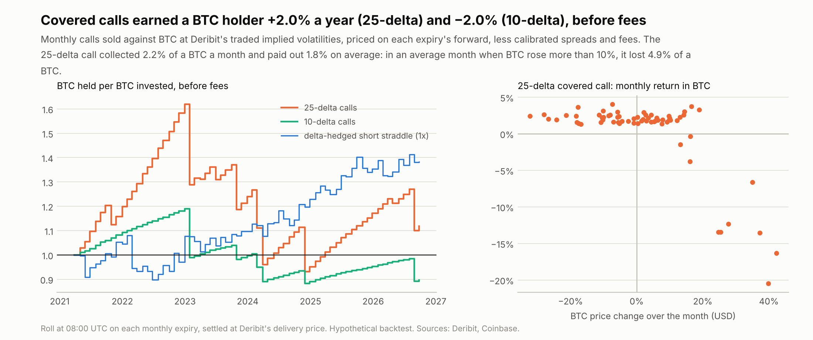
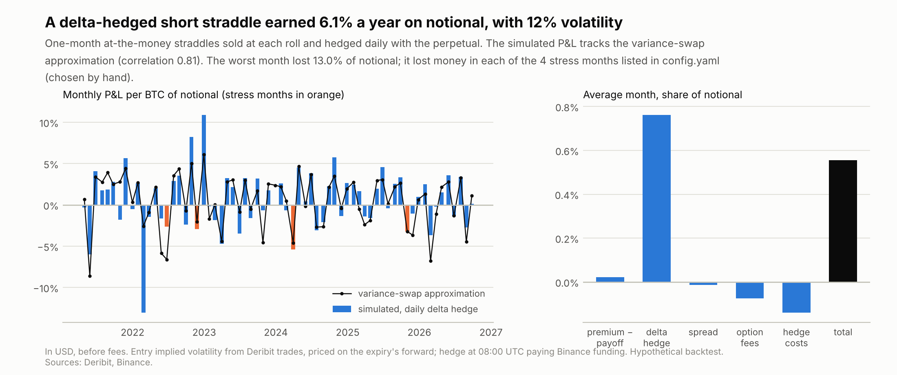
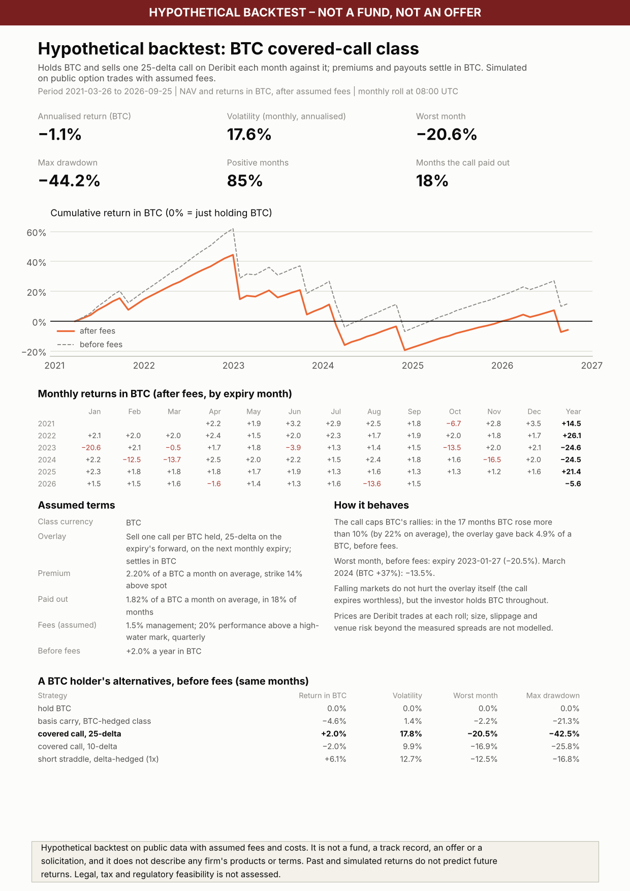

# Chapter 2: can a bitcoin investor earn a yield in bitcoin by selling options?

> Part of [One carry, five investors](../README.md). Public data from March 2021 (the launch of
> Deribit's DVOL index) to September 2026. Every number is written to
> `data/processed/vol_overlay/results.json` by `python -m src.pipeline` and checked by
> `python tests/check_readme.py`. Fees and terms are assumptions; this is a hypothetical backtest, not
> a trading recommendation.

The first chapter found that a basis carry pays a BTC-denominated investor nothing. To stay long BTC,
the class must buy back the very funding the strategy earns, and in the base case it lost 5.7% of its
BTC a year. Bitcoin-denominated funds therefore need a yield that is not the basis. Options are the
obvious candidate: they are quoted and settled in BTC on Deribit, and implied volatility usually sits
above the volatility that follows. This chapter asks:

> **How much more do BTC options price in than BTC then delivers, and how much of that can a BTC
> holder keep, in BTC, after giving up upside, paying spreads and living through the tails?**

## TL;DR

1. **The premium is real but mostly sits in the wings.**
   - DVOL, Deribit's 30-day implied-volatility index, averaged 59.8%; realised volatility over the
     following 30 days averaged 51.0%. That is a gap of 8.9 vol points, and DVOL was above realised
     on 72% of days.
   - DVOL is a variance-swap rate, so it prices the tails. At the 66 rolls, DVOL averaged 59.7%, the
     at-the-money options sold 54.7% and the volatility that followed 51.0%: the at-the-money premium
     was only 3.8 points, and positive in 61% of months.
   - The premium fell from 18.3 points in 2021 to 2.5 in 2026 to date.
2. **Covered calls returned little in BTC.**
   - Selling a 25-delta call against each BTC every month earned **+2.0% a year in BTC** before fees,
     with 18% volatility and a 42% drawdown in BTC terms. The 10-delta call lost 2.0% a year.
   - In the 17 months when BTC rose more than 10%, the 25-delta overlay gave back 4.9% of a BTC on
     average. In March 2024, when BTC rose 37%, it lost 13.5%.
3. **Fees turned the covered-call class negative.**
   - After the same assumed fees (1.5% management, 20% performance), the class returned −1.1% a year
     in BTC.
   - The performance fee took 1.9% a year: it was charged in calm quarters on gains that later rallies
     took back.
4. **The delta-hedged short straddle did best, and it was risky.**
   - It earned +6.1% a year on notional, in USD and in BTC, with 12% volatility and a 13.0% worst
     month.
   - It lost money in each of the four stress months listed in `config.yaml` (chosen by hand): June 2022, FTX in
     November 2022, March 2024 and October 2025.
5. **Timing and leverage signals do not help.**
   - Selling only when DVOL exceeds the past month's realised volatility lowered both strategies'
     returns.
   - Perp funding is almost uncorrelated with the at-the-money premium (0.01), though it moves with the
     level of implied volatility (0.28).
6. **Pricing on the forward matters.** Deribit quotes implied volatility against each expiry's
   forward, which sat a median 0.4% above the index at the rolls. Priced off the index, the traded
   options come out about 5% too cheap (calls) or too dear (puts); priced off the forward, the median
   error is under 0.1%.

## Data

| Series | Source | Coverage |
| --- | --- | --- |
| DVOL, hourly | Deribit `get_volatility_index_data` | from 24 Mar 2021 (launch), no missing hours |
| Delivery (settlement) prices, daily | Deribit `get_delivery_prices`, `btc_usd` | the index's 08:00 UTC 30-minute average; exactly one for every roll and expiry date |
| Option trades | `history.deribit.com` `get_last_trades_by_currency_and_time` | 176,447 trades within ±1 hour of the 08:00 UTC roll on each of 67 monthly expiries (1,124–5,362 per window) |
| BTC-USD hourly; perpetual funding | Coinbase; Binance (first chapter) | realised volatility; the straddle's delta hedge |

## Method

**Volatility premium.** Realised volatility uses daily BTC returns at 08:00 UTC, the expiry time:

$$RV_t = \sqrt{\tfrac{365}{30}\sum_{i=1}^{30} r_{t+i}^2}, \qquad VRP_t = DVOL_t - RV_t$$

**Pricing on the forward.** Deribit options are quoted and settled in BTC, and their implied
volatilities refer to the forward of each expiry, F, not to the index S. With zero rates, Black-76 on F
gives a call's dollar price C, and its BTC price is c = C / F. Put-call parity in BTC is therefore

$$c - p = 1 - K/F$$

(tested). No Deribit futures history is collected, so F is recovered from the option trades, as a
ratio to the index, for each roll window and expiry:

- **Put-call parity** (used in 54 of the 66 roll windows): F = K / (1 − (c − p)) from each call and
  put traded at the same strike within 5 minutes of each other, near the money; the window's median,
  when there are at least 5 pairs.
- **Otherwise** (12 windows), the median forward at which Black-76 at each near-the-money trade's
  quoted IV reproduces its price.
- The two methods agree to a median of 3.0bp in the 64 windows where both are available. The forward
  averaged 6.2% a year above the index, annualised.
- **Check.** Repricing all 34,867 front-month trades at their own IVs: on the index, calls come out
  −4.9% and puts +4.7% (median relative error); on the forward, −0.07% and −0.04% (median absolute
  error 0.36% and 0.38%).

Strikes are chosen by the forward delta N(d₁), the market's convention for "25-delta".

**Covered calls.** At 08:00 UTC on each monthly expiry (the last Friday), the expiring call settles
at Deribit's delivery price and a call on the next monthly expiry is sold. The monthly return in BTC is

$$R_m = c_m - \text{spread} - \text{fee} - \frac{\max(S_T - K,\,0)}{S_T} - \text{settlement fee}$$

- **Pricing.** The premium comes from the trades: the strike whose median forward delta is closest to
  the target (within 0.05), priced at the roll's forward with the median implied volatility of its
  trades.
- **Fallback.** Where no strike qualifies, Black-76 is used at DVOL plus a calibrated skew. This
  happened in 2 of 66 months for the 25-delta call and never for the 10-delta call. Where both exist,
  the trade-based premium averaged 0.02% of a BTC below the fallback.
- **Fees.** Deribit's taker fee is 0.03% of the underlying and its settlement fee 0.015%, both
  capped at 12.5% of the option's price.
- **Spreads, measured rather than assumed.** Across 35,941 front-month trades in the roll windows,
  sales executed below Deribit's mark by a median of 0.06 vol points at the money, 0.35 at 25-delta
  and 0.47 at 10-delta. Options are sold that far below mid; three times that spread is a sensitivity.
- **Skew.** Over all front-month (20–40-day) trades in the roll windows, the median implied
  volatility in the at-the-money and 25-delta buckets was 3.4–3.6 points below DVOL. This calibration
  median is a different statistic from the 4.9-point gap below, which is the mean over rolls at the
  strike actually sold.

**Market-neutral short volatility.** A one-month at-the-money straddle (one call and one put per BTC)
is sold at each roll, at the strike nearest the forward that traded on both sides.

- It is hedged once a day at 08:00 UTC with the Binance perpetual, to the straddle's forward delta at
  the entry volatility. The hedge pays or earns funding.
- P&L per BTC of notional, in USD, is premium − spread − fees − |S_T − K| + hedge P&L − funding −
  hedge costs. In BTC it is divided by S_T, since Deribit settles in BTC.
- **Cross-check.** A delta-hedged option earns about vega × (σᵢ² − σᵣ²) / (2σᵢ), the payoff of a
  variance swap. The simulation tracks this approximation with a correlation of 0.81, and a unit
  test checks the two agree on a known path.

## Results

### 1. The premium

| | 2021 | 2022 | 2023 | 2024 | 2025 | 2026 (to Sep) |
| --- | --- | --- | --- | --- | --- | --- |
| DVOL | 91% | 73% | 49% | 58% | 46% | 44% |
| Realised over the next 30 days | 73% | 61% | 43% | 49% | 41% | 41% |
| DVOL − realised (vol points) | 18.3 | 12.5 | 6.6 | 8.6 | 4.8 | 2.5 |

The headline premium is DVOL against realised volatility over every day. An at-the-money seller
collects less. Averaged over the 66 rolls, at the strike sold:

| At the rolls | Level | Gap |
| --- | --- | --- |
| DVOL | 59.7% | |
| At-the-money implied volatility | 54.7% | 4.9 points below DVOL |
| Realised over the following month | 51.0% | 3.8 points below at-the-money |

The 8.9-point headline (all days) and the 59.7% − 51.0% gap at the rolls are averages over different
dates. Most of the gap between DVOL and realised volatility is the price of the wings, which only a
seller of tail risk earns.

### 2. Covered calls

| In BTC, before fees, rolls 26 Mar 2021 – 25 Sep 2026 | 25-delta | 10-delta |
| --- | --- | --- |
| Return a year | +2.0% | −2.0% |
| Volatility (monthly, annualised) | 17.8% | 9.9% |
| Worst month | −20.5% (Jan 2023) | −16.9% (Jan 2023) |
| Max drawdown | −42.5% | −25.8% |
| Positive months | 85% | 91% |
| Premium, a month | 2.20% of a BTC | 0.72% of a BTC |
| Paid out, a month (average) | 1.82% of a BTC | 0.79% of a BTC |
| Months the call paid out | 18% | 9% |
| Strike above spot (average) | 14% | 28% |
| With three times the measured spreads | +1.3% a year | −2.5% a year |

- **Why the yield is small.** The call collects a steady premium and pays out in BTC's best months.
  Those months are large: BTC rose 22% on average in the 17 months it rose more than 10%. In USD the
  25-delta overlay returned 10.9% a year against 8.6% for holding BTC, but in BTC it added only 2.0%.
- **The 10-delta call** collected less than it paid out. The far-out-of-the-money calls were not
  cheap enough for BTC's right tail.

### 3. The delta-hedged short straddle

- **Return.** +6.1% a year in USD on notional (+6.1% in BTC), with 12.4% volatility, a 13.0% worst
  month (February 2022) and a 16.3% maximum drawdown. It was positive in 53% of months.
- **The average month** made 0.56% of notional:

  | Component | Share of notional |
  | --- | --- |
  | Premium minus payout | +0.02% |
  | Delta hedge (including funding) | +0.76% |
  | Spread | −0.01% |
  | Option fees | −0.08% |
  | Hedge costs | −0.14% |

  With three times the measured spreads the return falls only to 5.7% a year, because at-the-money
  spreads are thin.

### 4. Stress months

The four months below were chosen by hand, in `config.yaml`, as the sample's best-known stress events.

| Expiry month (roll to roll) | BTC price | 25-delta covered call (BTC) | 10-delta (BTC) | Short straddle (USD, on notional) |
| --- | --- | --- | --- | --- |
| June 2022 (Celsius, 3AC) | −28.0% | +2.6% | +0.6% | −2.6% (implied 70%, realised 95%) |
| November 2022 (FTX) | −18.3% | +2.4% | +0.6% | −2.9% (52% / 61%) |
| March 2024 (rally to a record) | +37.2% | −13.5% | −6.2% | −5.4% (53% / 69%) |
| October 2025 (10 Oct liquidations) | +0.3% | +1.4% | +0.4% | −3.2% (36% / 47%) |

- **Covered calls fail in rallies, not crashes.** In a crash the call expires worthless; the investor
  still holds BTC.
- **The straddle fails in both directions,** whenever realised volatility jumps above what was sold.

### 5. Signals and funding

- **Signal.** Selling only when DVOL exceeded the previous month's realised volatility (50 of 66
  months) made things worse:
  - the 25-delta covered call fell from +2.0% to −0.4% a year;
  - the straddle fell from +6.1% to +2.7%.
  The skipped months had been the better ones.
- **Funding.** Perp funding, the price of leveraged longs, correlates 0.28 with the level of implied
  volatility but 0.01 with the at-the-money premium, across 66 months. Months of high funding were
  months of high implied volatility, but not of a larger at-the-money premium; the link is a
  correlation, not tested causally.

### 6. A covered-call BTC class, after fees

[`reports/factsheet_btc_covered_call.pdf`](../reports/factsheet_btc_covered_call.pdf)

- **Before fees:** +2.0% a year in BTC.
- **After fees: −1.1% a year,** with a −44.2% drawdown in BTC terms.
- **The fees:** management took 1.5% a year and the performance fee 1.9%, paid in 6 quarters.

An option-selling strategy earns steadily and gives back in bursts. A quarterly performance fee
charges the steady part, and the high-water mark does not return it when the burst comes.

## Discussion: how to explain the overlay to a BTC-denominated investor

- **Covered calls trade BTC's best months for a small, steady income.** Over 2021–2026 that exchange
  added about 2% a year in BTC before fees and lost about 1% after them. It suits investors who would
  sell into rallies anyway, not those holding BTC for its upside.
- **The premium that exists is the price of tails.** Collecting it means selling volatility outright,
  hedged, and accepting a 13% worst month. Each of the four stress months examined lost money.
- **Fee design matters as much as the strategy.**
  - A quarterly performance fee over-charges any strategy with this return shape.
  - Longer crystallisation periods or a hurdle would align fees with what investors keep. Both are
    suggestions, not tested.
- **Neither yield is a substitute for a basis carry** in a USD class. For a BTC class they are what is
  available. The honest description is "a modest BTC yield with tail risk", not "free BTC".

## Limitations

- **Trade prices are for small sizes.** The spreads are measured from small trades. Larger sales would
  move the price, and capacity is not modelled.
- **Roll timing is fixed.** Premiums come from trades within an hour of the roll. Rolling at a
  different time, or splitting the sale across the day, would change them.
- **The forward is inferred,** from put-call parity or from the trades' own implied volatilities, not
  read from Deribit futures.
- **Hedging is idealised.** The straddle is hedged daily at the delivery price, which is an average.
  Intraday hedging and gap risk at the hedge are not modelled.
- **Not modelled:** margin for the short options, Deribit's portfolio-margin rules, and venue risk.
- **In-sample choices.** The skew used in the 2 fallback months is calibrated on the same trade
  sample, and the stress months were chosen knowing the sample's history.
- **One market history.** The sample has one bear market (2022) and several sharp rallies; the
  premium has fallen sharply since 2021.

## How I built this (this chapter)

The question came from the first chapter's finding that the basis carry gives a BTC investor nothing.
Measuring rather than assuming changed three things during the build: spreads, which turned out far
tighter at the money and wider in the wings than the 1-vol-point first guess; the premium, most of
which sits in the wings rather than at the money; and the underlying, since repricing the trades showed
that Deribit's implied volatilities refer to each expiry's forward, not the index. The unit tests cover
put-call parity on the forward, recovering the forward from parity and from implied volatilities, the
delta inversion, realised-volatility annualisation, strike selection, settlement on the expiry date's
delivery price, spread calibration, and the straddle against the variance-swap approximation; 13 of
the deliberate bugs in `tests/mutation_check.py` are in this chapter's code, and the suite catches
them all.
